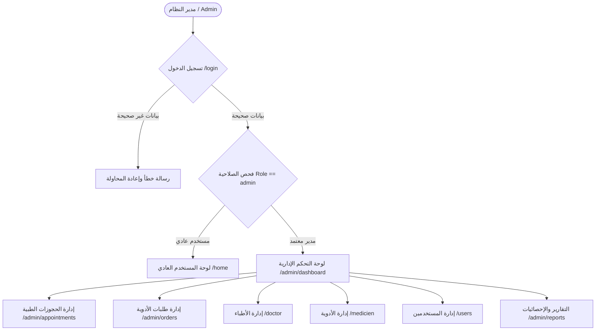
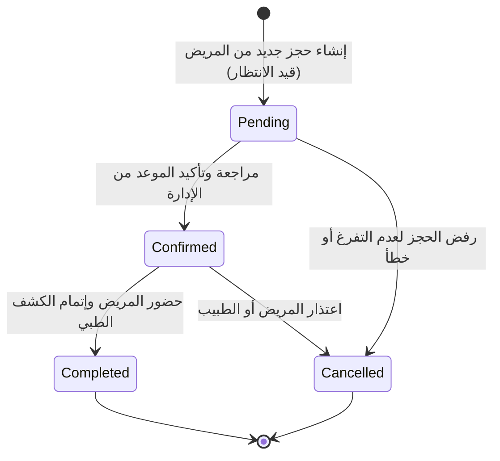
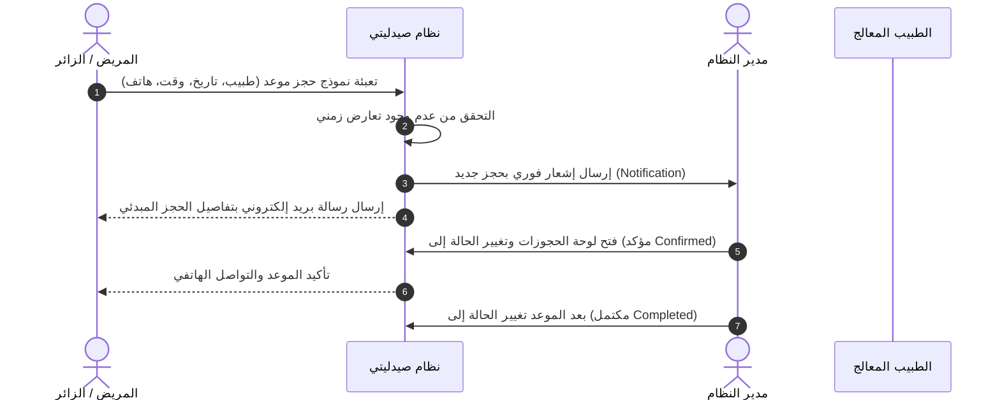
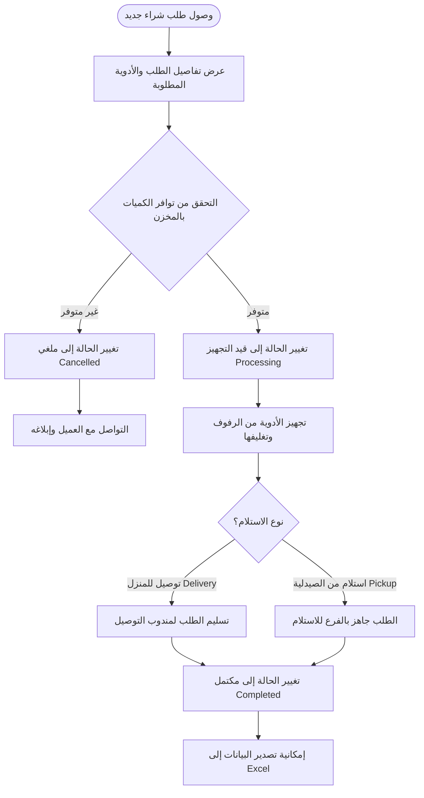
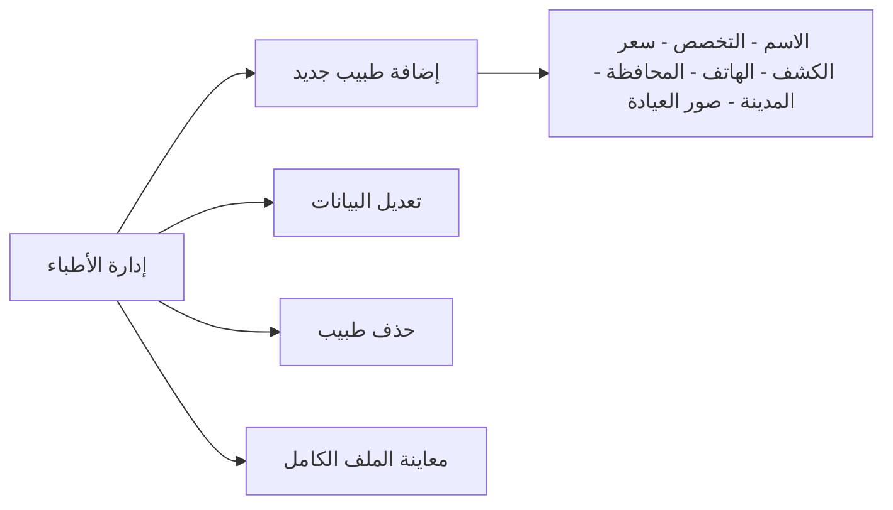
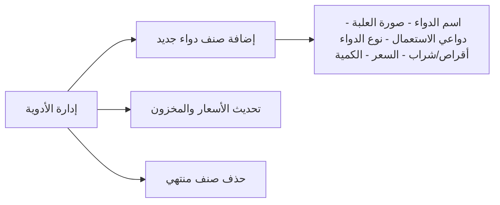
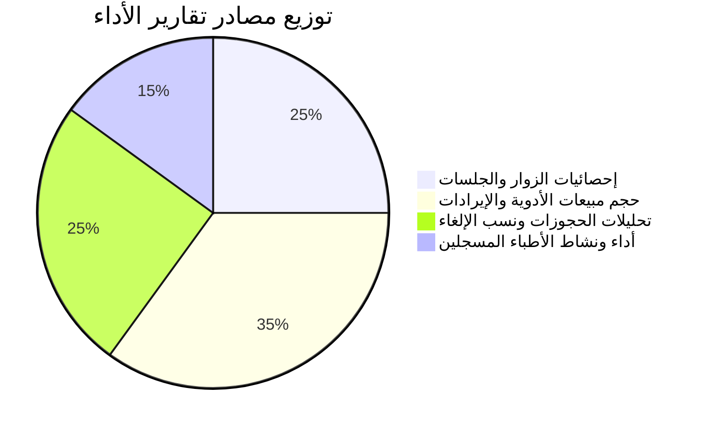

# دليل ومخطط تدفق لوحة التحكم الإدارية (Admin Dashboard Flow)

لوحة التحكم هي المركز الرئيسي لإدارة صيدلية ومنظومة **"صيدليتي"** الطبية. تتيح للمشرفين والمديرين متابعة كافة العمليات الحيوية: من حجوزات الأطباء، ومبيعات الأدوية، وحالات الطلبات، وإدارة الكوادر الطبية والمستخدمين، وصولاً إلى التقارير والتحليلات الإحصائية.

---

## 1. الهيكل العام ومخطط معمارية لوحة التحكم (Architecture Overview)

---

## 2. أقسام لوحة التحكم ووظائف كل قسم

### 2.1. الواجهة الرئيسية للوحة التحكم (`/admin/dashboard`)
- **كروت الإحصائيات الفورية:**
  - إجمالي عدد الأطباء المسجلين في المنظومة.
  - إجمالي عدد الأدوية والمستحضرات المتاحة بالمخزن.
  - إجمالي عدد المستخدمين والعملاء المسجلين.
- **الجداول السريعة:**
  - استعراض أحدث الحجوزات المسجلة.
  - استعراض أحدث الأدوية المضافة مع الأسعار والمخزون.
- **التنبيهات السريعة:** إشعار الإدارة الفوري عند وصول طلب جديد أو حجز جديد.

---

### 2.2. إدارة الحجوزات الطبية (`/admin/appointments`)

يتحكم المدير في دورة حياة الحجز الطبي منذ لحظة إرساله من المريض وحتى إتمامه.

#### دورة حياة الحجز (Appointment Lifecycle Flow):

#### تسلسل الأحداث والإشعارات للحجز (Sequence Flow):

---

### 2.3. إدارة طلبات الأدوية والمشتريات (`/admin/orders`)

يتيح هذا القسم متابعة طلبيات الأدوية التي تتم عبر المتجر الإلكتروني.

#### مخطط تدفق معالجة الطلب (Order Processing Flowchart):

- **المميزات المدمجة:**
  - **البحث المتقدم:** بالاسم، رقم الهاتف، البريد الإلكتروني، أو رقم الطلب (`Order ID`).
  - **تصدير إكسيل (Excel Export):** بنقرة واحدة لتحميل شيت إكسيل بجميع المبيعات للمحاسبة.

---

### 2.4. إدارة الأطباء والعيادات (`/doctor`)

---

### 2.5. إدارة الأدوية والمخزون (`/medicien`)

---

### 2.6. قسم التقارير والإحصائيات (`/admin/reports`)

يقوم بجمع وتحليل مؤشرات الأداء الرئيسية (KPIs) لمساعدة الإدارة في اتخاذ القرارات:

---

## 3. خريطة مسارات لوحة التحكم (Admin Sitemap)

| المسار (Route) | الوظيفة | الصلاحية المطلوبة |
| :--- | :--- | :--- |
| `/admin/dashboard` | الصفحة الرئيسية والإحصائيات العامة | مسجل كمدير `role: admin` |
| `/admin/appointments` | استعراض ومتابعة الحجوزات | مسجل كمدير `role: admin` |
| `/admin/appointments/{id}` | تفاصيل حجز كشف طبي لمريض | مسجل كمدير `role: admin` |
| `/admin/orders` | جدول طلبات الأدوية من المتجر | مسجل كمدير `role: admin` |
| `/admin/orders/{id}` | فاتورة تفصيلية ومحتويات الطلب | مسجل كمدير `role: admin` |
| `/admin/orders-export` | تصدير الطلبات كملف Excel | مسجل كمدير `role: admin` |
| `/admin/reports` | رسوم بيانية وتقارير المبيعات والحجوزات | مسجل كمدير `role: admin` |
| `/doctor` | قائمة الأطباء وإدارتهم (CRUD) | مسجل كمدير `role: admin` |
| `/medicien` | قائمة الأدوية وإدارتها (CRUD) | مسجل كمدير `role: admin` |
| `/users` | حسابات المستخدمين وصلاحياتهم | مسجل كمدير `role: admin` |
