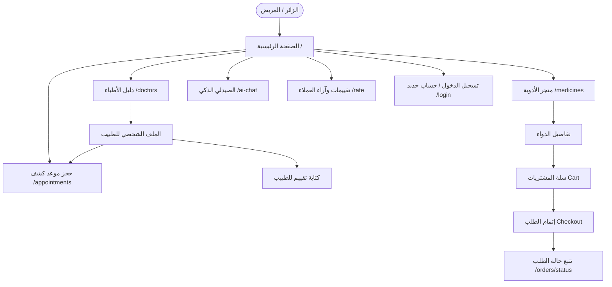
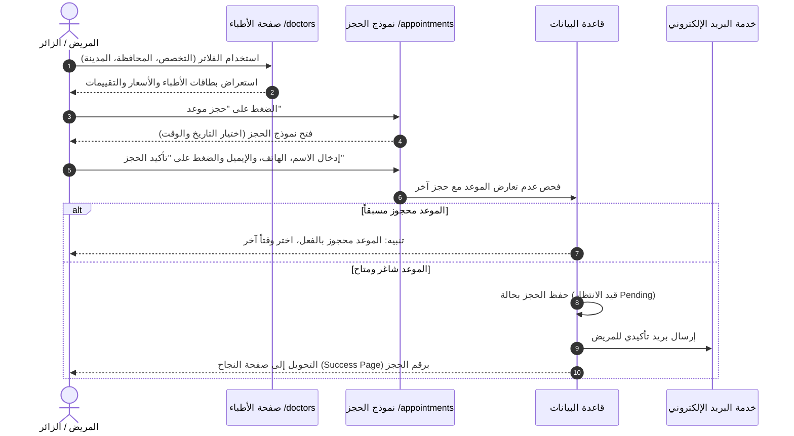
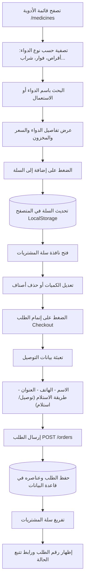
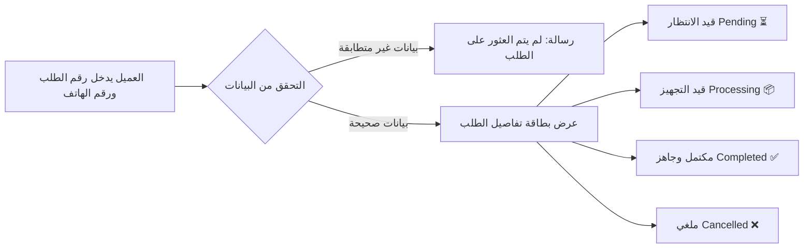
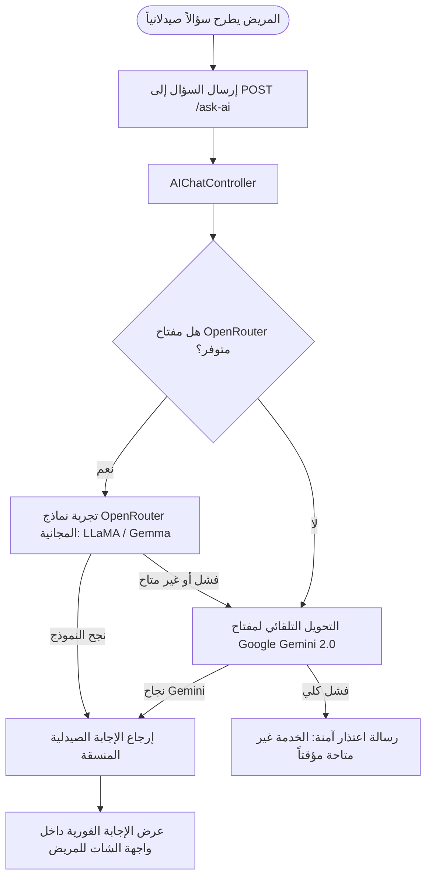

# دليل ومخطط تدفق الموقع الإلكتروني للمستخدمين (Website & User Flow)

الموقع الإلكتروني لمنظومة **"صيدليتي"** يمثل الواجهة الأمامية الشاملة الموجهة للجمهور والمرضى. يتيح للمستخدمين البحث عن الأطباء وحجز المواعيد، وتصفح الأدوية وطلبها عبر سلة المشتريات، والاستفادة من الصيدلي الذكي (AI)، ومتابعة حالات الطلبات.

---

## 1. خريطة رحلة المستخدم العامة (User Journey Map)

---

## 2. المسارات والخدمات الرئيسية بالتفصيل

### 2.1. الصفحة الرئيسية (Landing Page - `/`)
- **الهيرو سيكشن (Hero Section):** عنوان ترحيبي، ومقدمة عن خدمات الصيدلية والمنصة، مع أزرار سريعة "ابدأ الآن" و"تعرف على المزيد".
- **شريط التنقل الذكي (Smart Navigation):** يتكيف تلقائياً؛ حيث يعرض أزرار تسجيل الدخول وحساب جديد للزوار، أو اسم المستخدم ولوحة الحساب للمسجلين.
- **مربعات الميزات الستة (Features):**
  1. إدارة المخزون وتوفير الأدوية.
  2. التعامل مع الوصفات الطبية بدقة.
  3. الرسوم والتقارير.
  4. إدارة ملفات المرضى.
  5. نظام التنبيهات الفورية.
  6. التوافق التام مع الجوال والتابلت (Responsive).
- **التواصل والدعم الفني:** روابط سريعة ومعلومات التواصل في الفوتر.

---

### 2.2. رحلة البحث عن طبيب وحجز موعد (Doctor Search & Booking)

---

### 2.3. رحلة صيدلية ومتجر الأدوية والشراء (Medicine Store & Cart Flow)

---

### 2.4. تتبع حالة الطلب (Order Status Tracking)

---

### 2.5. الصيدلي الذكي ومساعد الذكاء الاصطناعي (AI Pharmacist Flow)

يوفر الموقع مساعداً طبياً وصيدلانياً يعمل بالذكاء الاصطناعي للإجابة عن استفسارات المرضى حول دواعي استعمال الأدوية، والجرعات، وتعارضات الأدوية:

---

### 2.6. التقييمات والمراجعات (Rating & Review Flow)

- **الرابط:** `/rate`
- **الشروط:** متاح للمستخدمين المسجلين بالموقع.
- **الخطوات:**
  1. اختيار الطبيب أو الخدمة.
  2. تحديد التقييم بالنجوم من (1 إلى 5 نجوم).
  3. كتابة التعليق ورأي المريض.
  4. حفظ التقييم ليظهر مباشرة في صفحة الطبيب لحساب متوسط تقييمه.

---

## 3. خريطة مسارات صفحات الموقع (Website Sitemap)

| اسم الصفحة | الرابط (Route) | نوع الوصول |
| :--- | :--- | :--- |
| الرئيسية | `/` | متاح للجميع |
| دليل الأطباء | `/doctors` | متاح للجميع |
| البحث عن طبيب | `/doctors/search` | متاح للجميع |
| تفاصيل الطبيب | `/doctors/{id}` | متاح للجميع |
| صيدلية الأدوية | `/medicines` | متاح للجميع |
| البحث في الأدوية | `/medicines/search` | متاح للجميع |
| تفاصيل الدواء | `/medicines/{id}` | متاح للجميع |
| حجز موعد كشف | `/appointments` | متاح للجميع |
| نجاح الحجز | `/appointments/success/{id}` | متاح للجميع |
| تتبع الطلبات | `/orders/status` | متاح للجميع |
| الصيدلي الذكي AI | `/ai-chat` | متاح للجميع |
| صفحة التقييمات | `/rate` | يتطلب تسجيل دخول |
| تسجيل الدخول | `/login` | للزوار غير المسجلين |
| تسجيل حساب جديد | `/register` | للزوار غير المسجلين |
| حسابي الشخصي | `/home` | للمستخدمين المسجلين |
